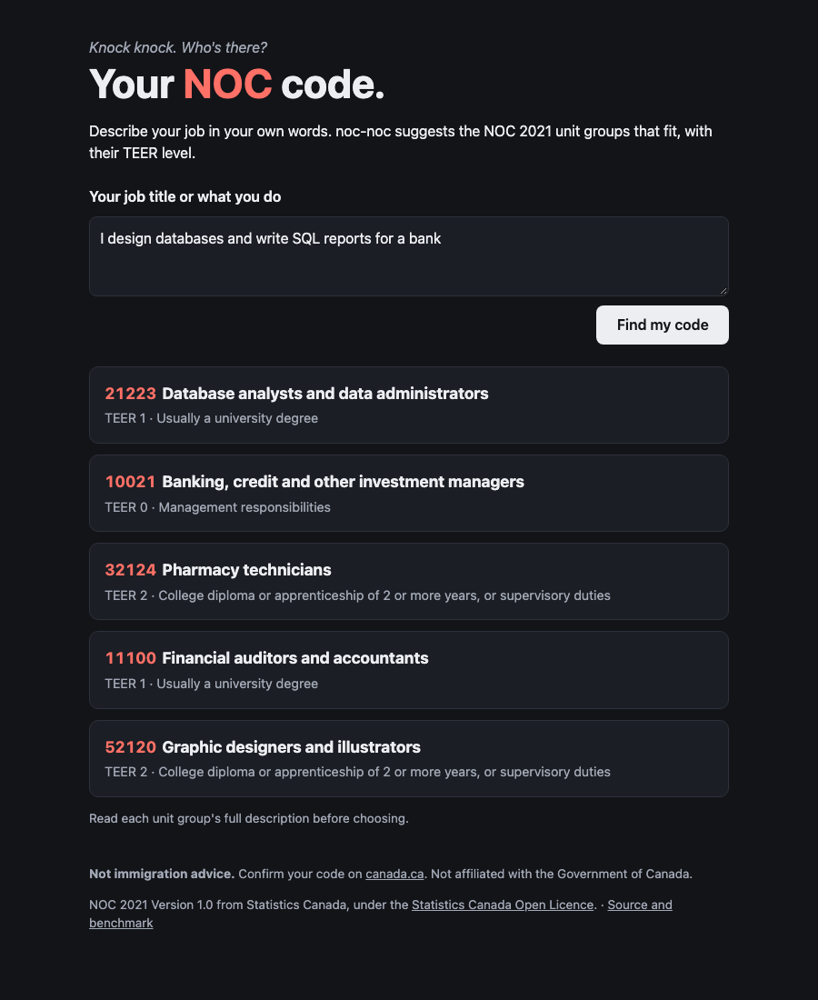

# noc-noc

[](https://github.com/AlanJuker/noc-noc/actions/workflows/ci.yml)

> *Knock knock. Who's there? Your occupation code.*

To apply for Express Entry, a work permit or most provincial programs, newcomers to Canada have to name their
occupation's **NOC code**, one of 516 unit groups in the National Occupational Classification. Job titles rarely
match the official names, and picking the wrong group is a common and costly mistake.

**noc-noc** suggests the NOC 2021 unit groups that fit a job title or description, with their TEER level, and
can explain which official duties match. Every retrieval method is measured on a held-out benchmark built from
Statistics Canada's own data before it's allowed into the product.



## Results

5,468 job titles from Statistics Canada, held out of the index ([how the benchmark works](docs/benchmark.md)):

| Method | top-1 | top-5 | MRR |
|---|---|---|---|
| TF-IDF baseline | 65.6% | 88.3% | 0.753 |
| Embeddings, one vector per unit group | 56.1% | 81.2% | 0.671 |
| Embeddings, one vector per title and duty | 68.9% | 93.5% | 0.795 |
| **Hybrid (reciprocal rank fusion)** | **72.2%** | **93.6%** | **0.816** |
| Hybrid + Claude reranking | *not measured yet* | | |

What the numbers decided:

- **The obvious embedding design lost to TF-IDF.** One vector per unit group blurs about 50 job titles together
  and gets truncated. One vector per title and duty, scoring a group by its best passage, wins.
- **The hybrid ships**: the right code is in the first five answers for 93.6% of held-out titles.
- **The remaining mistakes are increasingly genuine ambiguity.** 41% of the hybrid's wrong first answers are
  pairs that Statistics Canada's own exclusions list as easy to confuse.

### Known gap

The benchmark covers job titles, but people describe their work in sentences, and that's where the hybrid is
weakest ("I drive for Uber at night" ranks hotel front desk clerks first). Measuring descriptions is
[#12](https://github.com/AlanJuker/noc-noc/issues/12); it's also where the Claude reranker should earn its
cost.

## How it works

```
job title or description
        │
        ├─► TF-IDF over each unit group's title, examples, definition, duties ─┐
        │                                                                     ├─► reciprocal rank fusion ─► top 10
        └─► bge-small embeddings, best passage per unit group ────────────────┘                              │
                                                                                optional: Claude reranks and cites duties by id
```

- **Domain**: NOC 2021 unit groups, TEER, exclusions and the pairs they mark as easy to confuse.
- **Application**: the benchmark (deterministic hash split, no leakage), and a reranker that drops anything the
  language model can't back up: codes that weren't candidates, and duty ids that don't belong to the code.
- **Infrastructure**: Statistics Canada loader, TF-IDF (scikit-learn), embeddings (fastembed / ONNX, CPU only,
  vectors cached on disk), Claude (`claude-opus-5-5`, low effort, strict JSON schema).
- **Interface**: CLI, JSON API and a server-rendered page with HTMX that also works without JavaScript.

## Run it

```bash
uv sync
uv run noc-noc search "full stack developer"
uv run noc-noc eval                       # reproduces the table (first run builds the vectors, ~3 min)
uv run uvicorn noc_noc.api.main:build_app --factory --reload   # http://localhost:8000
```

With `ANTHROPIC_API_KEY` set, the page offers explanations and the CLI accepts `--method rerank`. Evaluating
the reranker uses a fixed sample of 200 titles (about $3.50) unless `--sample` says otherwise:

```bash
uv run noc-noc eval --method hybrid --method rerank --sample 200
```

## Tests and CI

63 tests at 95% coverage, `mypy --strict` and ruff on every push. The language model is tested against a mocked
HTTP API, and CI never downloads the embedding model: a deterministic word-hashing embedder stands in for it.

## Data and disclaimer

NOC 2021 Version 1.0 from Statistics Canada, under the
[Statistics Canada Open Licence](https://www.statcan.gc.ca/en/terms-conditions/open-licence).

**Not immigration advice**, and not affiliated with the Government of Canada. Always confirm your code on
[canada.ca](https://www.canada.ca/en/immigration-refugees-citizenship/services/immigrate-canada/find-national-occupation-code.html).

## License

[MIT](LICENSE)
